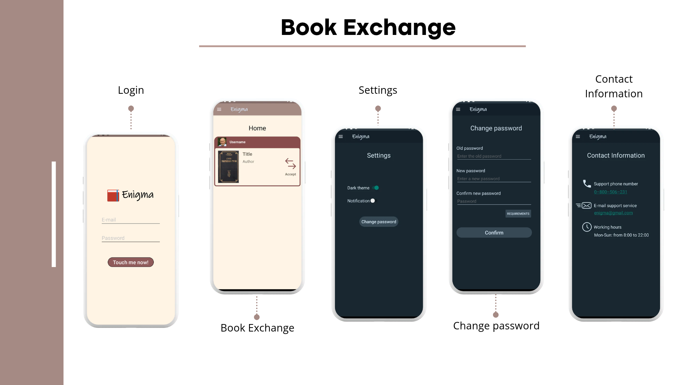

# Enigma — Book Exchange Mobile App

A mobile application for exchanging books between users.

## Main Features

- User authentication
- Book exchange feed (view offers, accept or decline)
- Settings:
  - Dark theme
  - Notifications
  - Change password
- Contact information

## Technologies

- Java
- Material Design
- AppCompat

## Screenshots

## Author

Vladyslav Bilous  
Kharkiv National University of Radio Electronics  
Specialty 121 — Software Engineering
